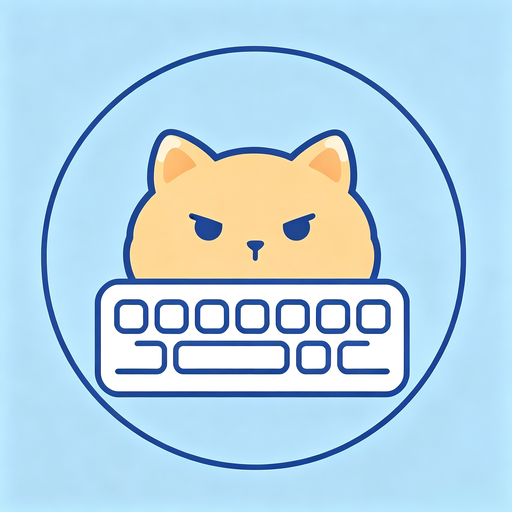

<div align="center">



# Hajimi Virtual Keypad

[简体中文](README.md) · **English**

**A draggable virtual keyboard, joystick and mouse overlay for Android games — no root, no game modification.**

[](https://github.com/114514hhha233/shizuku-keypad/releases)
[]()
[](LICENSE)
[](https://shizuku.rikka.app/)

**[⬇ Download APK](https://github.com/114514hhha233/shizuku-keypad/releases/download/v1.6.1/shizuku-keypad-1.6.1.apk)** ·
[Source](https://github.com/114514hhha233/shizuku-keypad) ·
[Issues](https://github.com/114514hhha233/shizuku-keypad/issues)

</div>

Add a freely placeable virtual keyboard and mouse to Android games: every key is its own floating window, and **Shizuku** injects key events into the system input layer, so cloud gaming, game streaming, emulators and native mobile games all work — no root and no game modification required.

- Package: `com.example.shizukukeypad`
- Version: 1.6 (versionCode 8)
- Min Android: 8.0 (API 26), target API 34
- Dependency: Shizuku 13.x (`dev.rikka.shizuku:api/aidl/provider:13.1.5`)
- Language: follows the system; Simplified Chinese and English included

> Experimental project — not yet validated on a wide range of devices and games. Feedback is welcome.

---

## Features

### Keys
- Each key is its own `TYPE_APPLICATION_OVERLAY` window, freely draggable, resizable (40–120dp, with one-tap presets 40/50/60/70/80/90/100/120), round or rounded-square.
- Two injection modes:
  - **Keyboard keys**: inject `KeyEvent` (keyDown / keyUp) via Shizuku — works with cloud gaming, streaming and remote desktop.
  - **Touch keys**: the window is set to `FLAG_NOT_TOUCHABLE`, so fingers pass straight through to the game and the system provides **native multi-touch** with zero injection latency; pressing several touch keys at once is true multi-finger input.
- **Lock key**: tap once to hold, tap again to release — great for continuous movement or sprinting.
- **Macros**: steps separated by comma or space, `+` means pressed together, e.g. `Ctrl+Shift+K, A`.
- Custom keyCode: any Android `KeyEvent` keyCode (1–400) can be entered directly.
- Toggle: when the toolbar master switch is off, checked keys are hidden entirely.

### Virtual joystick
- **Key-value mode**: 8-direction output with a 22% center dead zone; on a direction change only release/press deltas are emitted. Default **W / S / A / D** (51 / 47 / 29 / 32); each direction can be remapped.
- **Touch mode**: injects one finger at an output point to push the game's own joystick; displacement is clamped to the stick travel. The output point can be dragged with a yellow crosshair in edit mode.
- The stick head follows your finger and can be repositioned in edit mode.

### Thumb rest
A small translucent area that **sends no keys** — it only holds the gesture.

Android has a hard rule for multi-touch: once a finger goes down, the gesture belongs to the window it landed on; if the first finger lands on the game, all subsequent fingers go to the game and the overlay never receives them. Conversely, if the first finger lands on our window, later fingers keep coming to us and we can route them by screen coordinates.

So: **keep your thumb on the thumb rest (or joystick, or any key) and your other hand can freely look around and press new keys**. This is the only stable "full-screen multi-touch" approach.

### Full keyboard
- One QWERTY keyboard window; all keys are routed by pointerId, so simultaneous presses don't steal each other's keys.
- Drag the three-bar handle to move it; pinch to zoom and remember width.
- Letter/symbol layers, Caps and Shift handling.
- Mutually exclusive with individual keys to avoid overlap.

### Mouse
- Trackpad-style dragging: slide to move the cursor, tap the pad for left click.
- Separate cursor window; mouse buttons (left/middle/right, wheel up/down) are injected at the cursor position.
- Sensitivity 50%–250%; drag-lock (left button held) can optionally drag across the whole screen.

### Editing & configuration
- Toolbar: edit mode, mouse, full keyboard, toggle, all-off/all-on (hide every key at once), macro binding, opacity.
- In edit mode, drag keys, tap to edit, long-press to delete.
- Layout, opacity, sensitivity and toggle states persist via `SharedPreferences + JSON`; key positions are stored as 0–1 ratios, so rotation and resolution changes never misplace them.
- Preset management and config import/export.
- Optional "block system IME": temporarily swap in a blank IME so the system keyboard doesn't cover the screen.
- Foreground service keeps the overlay alive after switching to a game.
- UI text follows the system language; Simplified Chinese and English included.

---

## How it works

### 1. Why Shizuku
A normal app has only three ways to inject keys: accessibility (high latency, detectable by games), IME (text only, no modifier combos), or root. Shizuku starts a privileged process via `adb shell` or root and hands the app the `IInputManager` binder, so it can call directly:

```
IInputManager.injectInputEvent(event, MODE_WAIT_FOR_FINISH)
```

The injected events are system-level input, indistinguishable from real ones, and require no special permission.

### 2. Why each key is a separate window
If all keys were drawn in one large window, that window would cover the whole screen, swallow injected taps, and the system would attribute all touch in that region to it. Separate small windows solve this:

- only the key's small area participates in touch hit-testing, so the game view is never occluded;
- each key's injection coordinates are its window's real screen coordinates — no manual rotation/offset math;
- the window uses `FLAG_SPLIT_TOUCH`, so multiple fingers can land on different key windows.

### 3. Move out of the way before injecting
Injected touches go through the same dispatch path as real fingers and hit the topmost touchable window at those coordinates. If our own overlay is in the way, the injection bounces back to us (symptom: the key flashes and the game does nothing). So before injecting, blocking windows are temporarily set to `FLAG_NOT_TOUCHABLE` and restored afterwards.

Touch keys are the opposite: they are never touchable, so fingers pass straight through and use native multi-touch with zero injection latency.

### 4. Multi-finger routing
`FLAG_SPLIT_TOUCH` only guarantees that the window the first finger landed on keeps receiving subsequent fingers. So each key window does a second-level dispatch:

- down: record pointer → key;
- later fingers outside a key: decide by screen coordinates, or forward the whole pointer to the game (`forwardDown / forwardMove / forwardUp`);
- up: release the key or forward the pointer up.

This is why you can press keys while tapping and dragging elsewhere, and how the thumb rest works.

### 5. Coordinates and persistence
Screen size comes from `currentWindowMetrics` (real pixels for the current rotation); key positions are stored as ratios, so rotation and device changes follow automatically.

---

## Known limitations

- **Can't press keys while swiping the camera**: as described above, once the first finger lands on the game, the gesture belongs to the game. Keep one finger on the thumb rest / joystick / a key.
- **No full-screen capture layer**: a full-screen window blocks injected events (self-loop); making it non-touchable means it receives no fingers; toggling touchability mid-gesture is cancelled by the system. These three cannot hold at once — it's a window-dispatch rule, not an app-permission issue.
- **Touch keys and joystick touch mode depend on injection**: injected fingers are a separate input stream; a few games/apps may ignore them or behave oddly near system gesture edges.
- **No iOS / no-Shizuku mode**: without Shizuku you can only view the layout, not inject.
- For cloud gaming/streaming, prefer keyboard-key mode; for native mobile games, prefer touch-key / joystick touch mode.

---

## Install & usage

1. Download `shizuku-keypad-1.6.1.apk` from [Releases](https://github.com/114514hhha233/shizuku-keypad/releases) and install it.
2. Install [Shizuku](https://shizuku.rikka.app/) and start its service via `adb shell` or root as described in its documentation.
3. Open the app and grant "Display over other apps" and notification permissions.
4. Tap "Authorize Shizuku" in the app; the status should become connected.
5. Tap "Show virtual keys" to launch the overlay; go back to the home screen or a game and the toolbar and keys appear.
6. Tap "Edit" on the toolbar to enter edit mode, tap "+" to add keys and drag them into place; exit edit mode to use.

---

## Build

Requires JDK 17 and Android SDK 34. The repo does not include a Gradle wrapper; use a local Gradle 8.x:

```bash
export ANDROID_HOME=/path/to/android-sdk
gradle :app:assembleDebug
# Output: app/build/outputs/apk/debug/app-debug.apk
```

---

## Project structure

| File | Responsibility |
| --- | --- |
| `KeypadOverlay.kt` | Overlay core: key windows, touch dispatch, injection, joystick, trackpad, edit mode, full keyboard, toolbar |
| `KeyModel.kt` | Key data model, key catalog, macro parser, SharedPreferences/JSON persistence |
| `JoystickPad.kt` | Joystick widget: dial + stick head drawing and edit dragging |
| `ShizukuInjector.kt` | Shizuku binder and input injection: keys, touch, mouse, multi-touch pointer management |
| `OverlayService.kt` | Foreground service hosting the overlay |
| `MainActivity.kt` | Authorization, toggles, opacity/sensitivity, presets, import/export |
| `AboutActivity.kt` | About page |
| `ImeGuard.kt` / `NoopImeService.kt` | Blank IME used to block the system keyboard |
| `res/layout/dialog_key.xml` | Key config dialog (with joystick options) |

---

## Permissions

| Permission | Purpose |
| --- | --- |
| `SYSTEM_ALERT_WINDOW` | Draw floating keys and toolbar |
| `moe.shizuku.manager.permission.API_V23` | Call Shizuku to inject input events |
| `FOREGROUND_SERVICE` / `FOREGROUND_SERVICE_SPECIAL_USE` | Keep the overlay alive |
| `POST_NOTIFICATIONS` | Foreground service notification (Android 13+) |
| `BIND_INPUT_METHOD` (service declaration) | Blank IME, only when "block system IME" is enabled |

The app has no network access and collects no data; configuration stays on the device.

---

## Disclaimer

This project is for learning and personal use only. Follow the terms of service of the games/platforms you use, do not use it in competitive online multiplayer games, and you are responsible for any consequences.
