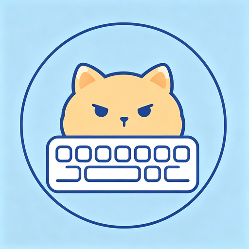

<div align="center">



# HJM Keypad

**简体中文** · [English](README.en.md)

**在 Android 上给游戏加一套可自由摆放的虚拟键鼠：多点触控热区让「滑视角」和「按新键」同时发生——不用 root，不用改游戏。**

[](https://github.com/114514hhha233/shizuku-keypad/releases)
[]()
[](LICENSE)
[](https://shizuku.rikka.app/)

**[⬇ 下载 APK](https://github.com/114514hhha233/shizuku-keypad/releases/download/v1.7/HJM-Keypad-1.7.apk)** ·
[源码](https://github.com/114514hhha233/shizuku-keypad) ·
[问题反馈](https://github.com/114514hhha233/shizuku-keypad/issues)

</div>

HJM Keypad（原名「哈基米虚拟键盘」）在 Android 上给游戏加一套可自由摆放的虚拟键盘和鼠标：按键是独立悬浮窗，通过 **Shizuku** 把按键 / 触摸 / 鼠标事件注入系统输入层，云游戏、串流、模拟器、原生手游都能用；不需要 root，也不需要改游戏。

- 应用名：HJM Keypad（包名不变，可直接覆盖升级）
- 包名：`com.example.shizukukeypad`
- 版本：1.7（versionCode 10）
- 最低系统：Android 8.0（API 26），targetSdk / compileSdk 34
- 依赖：Shizuku 13.x（`dev.rikka.shizuku:api/aidl/provider:13.1.5`）、Material Components 1.12
- 语言：跟随系统，内置简体中文与英文

> 项目为实验性质，尚未在大量机型与游戏上验证，欢迎反馈问题。

---

## 多点触控（核心，默认开启）

这是这个项目最重要的部分：**用坐标算法做热区，让「一边滑视角、一边按新键」真正成立。**

### 它解决什么问题

Android 的触摸流有归属：一旦第一根手指落在游戏窗口，这次手势就归游戏所有，后续手指全部发给游戏，悬浮层再也收不到。注入的「假手指」属于另一条输入流，无法在触摸屏上占位（Android 15 实测），所以靠注入抢触摸这条路走不通。

### 怎么实现

多点触控模式下，所有按键窗口都设为 `FLAG_NOT_TOUCHABLE`，不再抢触摸。真正的触发出现在旁听侧：

1. 通过 **Shizuku**（shell 身份）执行 `getevent -lp` 列出触摸屏设备，读取 `ABS_MT_POSITION_X/Y` 的 `min/max` 量程；随后 `getevent -lt` 持续读取 `/dev/input/event*` 的原始事件。**只读不消费**——事件已经被系统照常发给游戏，我们只是同时看见每根手指的坐标。
2. 解析原始事件里的多指信息：`ABS_MT_SLOT`（手指槽位）、`ABS_MT_TRACKING_ID`（手指身份）、`ABS_MT_POSITION_X/Y`（原始坐标），在 `SYN_REPORT` 时一次性结算这一帧。
3. **坐标算法**：先把绝对坐标归一化 `(raw - min) / (max - min)`，再按 `Surface.rotation` 映射到当前屏幕方向，得到屏幕像素：

   ```
   ROTATION_0   : (nx * W, ny * H)
   ROTATION_90  : (ny * W, (1 - nx) * H)
   ROTATION_180 : ((1 - nx) * W, (1 - ny) * H)
   ROTATION_270 : ((1 - ny) * W, nx * H)
   ```

4. **热区命中**：每根手指按下时，用它换算出的屏幕坐标去命中每个按键的真实屏幕矩形（窗口位置 + 宽高）。命中即触发该按键的注入；抬起时按手指身份释放对应的键。按在空白处的手指则用来拖动全屏鼠标光标。

### 效果

- **滑动视角的同时也能按新键**：第一根手指落在游戏上，后续手指照样能触发按键；
- 多根手指可以同时按在不同按键上，互不干扰；
- 按键不再挡触摸，游戏原生触摸完整保留；
- 鼠标左 / 右 / 中键、滚轮在多点触控下都可用；全屏鼠标支持多指拖动光标，轻点空白处 = 鼠标左键。

### 与悬浮窗模式的区别

| | 多点触控（默认） | 悬浮窗模式 |
| --- | --- | --- |
| 按键窗口 | 一律不可触摸 | 独立窗口 + `FLAG_SPLIT_TOUCH` |
| 第一根手指 | 落在哪都不影响 | 必须落在按键窗口上 |
| 滑动视角时按键 | ✅ 可以 | ❌ 收不到后续手指 |
| 原生触摸 | 完整保留 | 全屏鼠标会挡住 |
| 摇杆 / 触控板手势 | ❌ 不支持 | ✅ 支持 |
| 依赖 | Shizuku + `getevent` 旁听 | Shizuku 注入 |

工具栏「◈ 多点触控」默认打开；点一下切到「悬浮窗」模式（适用于不支持旁听触摸的设备）。

---

## 功能

### 按键
- 每个按键一个独立 `TYPE_APPLICATION_OVERLAY` 窗口，可自由拖动、改大小（40–120dp，支持「常用尺寸」一键选择 40/50/60/70/80/90/100/120）、圆形 / 圆角方形。
- 两种注入方式：
  - **键盘事件**：通过 Shizuku 注入 `KeyEvent`（down/up），云游戏、串流、远程桌面可用，可按住。
  - **触摸点击**：在按键位置注入手指，原生手游可用，按住时保持触摸。
- **锁定键**：点一下保持按住，再点一下松开。
- **宏**：逗号或空格分隔步骤，步骤内 `+` 表示同时按下，如 `Ctrl+Shift+K, A`。
- 自定义键值：直接填 Android `KeyEvent` keyCode（1–400）。
- 一键开关：勾选后，工具栏总开关关闭时该按键整体隐藏。
- 全关 / 全开：一键隐藏屏幕上所有按键，再点恢复。

### 虚拟摇杆
- **键值模式**：8 方向输出，中心 22% 死区，默认 W/S/A/D（51/47/29/32），方向键值可改。
- **触摸模式**：在输出点注入手指推游戏摇杆，输出点可在编辑模式用准星拖动。
- 摇杆暂不支持多点触控，需要在悬浮窗模式使用。

### 鼠标
- **全屏鼠标**（默认）：整块屏幕滑动移动光标；轻点左键、双指点按右键、双指上下滑动滚轮。
- **触控板**：小面板拖动移动光标（长按工具栏「↖ 鼠标」切换）。
- 光标独立悬浮窗，鼠标键注入在光标位置；灵敏度 50%–250%。

### 整块键盘
- 一整块 QWERTY 键盘，同一窗口内按 pointerId 分发多指。
- 顶部拖动、双指缩放、字母层 / 符号层、Caps / Shift。

### 编辑与配置
- 工具栏：编辑、添加、宏、全关、关闭、存 / 读、整块、一键开、鼠标、多点触控。
- 编辑模式下直接拖动按键、点按键改配置、长按删除。
- 按键编辑对话框为分组卡片布局：键位、显示、行为、摇杆、注入方式分开，尺寸可选常用档位。
- 布局 / 透明度 / 灵敏度 / 开关状态用 `SharedPreferences + JSON` 持久化；位置存 0–1 比例，旋转与换分辨率不会错位。
- 预设管理与配置导入导出（剪贴板 JSON）。
- 可选「拦截系统输入法」：显示按键期间用空白输入法顶替，避免键盘遮挡或字母转中文。
- 主界面为 Material 3 风格，Android 12+ 动态取色；内置独立帮助页（帮助与常见问题）。

---

## 工作原理

### 1. 为什么需要 Shizuku
普通应用注入按键只有无障碍（延迟高、易被识别）、输入法（只能输入文字）、root 三条路。Shizuku 通过 `adb shell` 或 root 启动特权进程，把 `IInputManager` binder 交给应用，可直接调用：

```
IInputManager.injectInputEvent(event, MODE_WAIT_FOR_FINISH)
```

注入的是系统级输入事件，游戏无法区分。

### 2. 为什么每个按键独立成窗口
一张大窗口会挡住整块屏幕，注入的点击会被自己吃掉，还会把整片区域的触摸都算给它。独立小窗口只有按键区域参与命中，注入坐标就是窗口真实屏幕坐标，并可用 `FLAG_SPLIT_TOUCH` 让多指分别落到不同按键。

### 3. 多点触控为什么用 evdev 旁听
见上方「多点触控」一节：触摸流有归属，注入的假手指不能占位，所以改为旁听触摸屏原始事件，只读不抢，游戏照常收到原生触摸，我们用它做按键热区命中。坐标换算为 `(raw - min) / (max - min)` 后再按屏幕方向旋转。

### 4. 悬浮窗模式与全屏鼠标的取舍
全屏鼠标必须铺一层全屏触摸窗口来接收滑动，这层会挡住原生触摸——这是窗口分发规则的必然结果。多点触控模式不铺这层，原生触摸可到达游戏；但游戏收到注入的鼠标移动后可能切到「鼠标视角」，相机不再跟随触摸，属于游戏自身的输入模式切换。

### 5. 注入前先让开
注入事件会命中「最上层可触摸窗口」。若目标位置被自己的浮层挡住，注入会打回自己身上，所以注入前会临时把挡路窗口设为 `FLAG_NOT_TOUCHABLE`，注入完恢复。

### 6. 坐标与持久化
屏幕尺寸取 `currentWindowMetrics`（当前旋转下的真实像素），按键位置存比例，旋转、换设备自动跟随。

---

## 已知限制

- 多点触控模式依赖 Shizuku 与 `getevent`，个别机型触摸设备节点 / 坐标系不同，可能不生效。
- 多点触控不接管原生触摸，所以按键操作会同时传给下层游戏。
- 全屏鼠标 + 悬浮窗模式会挡住原生触摸；需要原生触摸请用多点触控或关闭虚拟鼠标。
- 摇杆、触控板手势（双指点按等）不支持多点触控。
- 注入的触摸是独立输入流，少数游戏可能不认。
- 不支持 iOS / 免 Shizuku 模式。

---

## 安装与使用

1. 从 [Releases](https://github.com/114514hhha233/shizuku-keypad/releases) 下载 `HJM-Keypad-1.7.apk` 并安装。
2. 安装 [Shizuku](https://shizuku.rikka.app/)，并按官方说明通过 `adb shell` 或 root 启动服务。
3. 打开应用，授予「悬浮窗」和「通知」权限。
4. 在应用内点「授权 Shizuku」，允许后状态变为已连接。
5. 点「启动悬浮层」，回到桌面/游戏即可看到工具栏与按键；多点触控默认已开启。
6. 点工具栏的「编辑」进入编辑模式，点「＋」添加按键，拖到合适位置；退出编辑即可使用。

---

## 构建

需要 JDK 17、Android SDK 34。仓库未附带 Gradle Wrapper，用本地 Gradle 8.x：

```bash
export JAVA_HOME=/path/to/jdk17
export ANDROID_HOME=/path/to/android-sdk
gradle :app:assembleDebug
# 产物：app/build/outputs/apk/debug/app-debug.apk
```

安装包使用 debug 签名，可直接覆盖安装升级（包名不变）。

---

## 项目结构

| 文件 | 职责 |
| --- | --- |
| `KeypadOverlay.kt` | 悬浮层主体：按键窗口、触摸分发、注入、摇杆、触控板、整块键盘、多点触控热区、工具栏 |
| `EvdevTouch.kt` | Shizuku 旁听触摸屏原始事件，坐标换算后输出屏幕坐标 |
| `KeyModel.kt` | 按键模型、键位目录、宏解析、持久化 |
| `JoystickPad.kt` | 摇杆控件 |
| `ShizukuInjector.kt` | Shizuku binder 与按键 / 触摸 / 鼠标注入 |
| `OverlayService.kt` | 前台服务，承载悬浮层 |
| `MainActivity.kt` | 授权、开关、外观设置、预设、导入导出 |
| `HelpActivity.kt` | 帮助与常见问题页 |
| `AboutActivity.kt` | 关于页 |
| `ImeGuard.kt` / `NoopImeService.kt` | 空白输入法，用于拦截系统输入法 |
| `res/layout/` | M3 主界面、帮助页、关于页、按键配置对话框 |
| `res/values/themes.xml` | `Theme.Material3.DynamicColors.DayNight.NoActionBar` |

---

## 权限说明

| 权限 | 用途 |
| --- | --- |
| `SYSTEM_ALERT_WINDOW` | 绘制悬浮按键与工具栏 |
| `moe.shizuku.manager.permission.API_V23` | 调用 Shizuku 注入输入事件、旁听触摸 |
| `FOREGROUND_SERVICE` / `FOREGROUND_SERVICE_SPECIAL_USE` | 前台服务保活悬浮层 |
| `POST_NOTIFICATIONS` | 前台服务通知（Android 13+） |
| `BIND_INPUT_METHOD`（服务声明） | 空白输入法，仅在开启「拦截系统输入法」时使用 |

应用不申请网络权限、不收集数据；配置只保存在本机。

---

## 版本记录

- 1.7：更名为 **HJM Keypad**、猫头键盘新图标（自适应图标）、多点触控模式默认开启（evdev 旁听 + 坐标热区）、主界面 Material 3 重构（动态取色）、独立帮助 / 常见问题页、按键编辑对话框重绘、全屏鼠标多指拖动与轻点左键。
- 1.6：整块键盘、热区实验、国际化、按键常用尺寸。
- 1.5：预设按键、常用尺寸窗口、一键全关。

---

## 免责声明

本项目仅供学习与个人使用。请遵守所玩游戏 / 平台的服务条款，不要在多人在线竞技游戏中使用，由此产生的一切后果由使用者自行承担。
